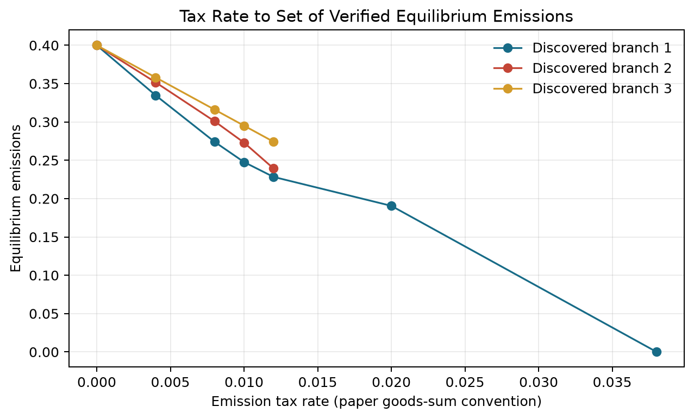

# Duanmu GE Lab: Professor Demo

## 1. Motivation

The project asks whether the finite quota and emission-tax examples in Anderson-Duanmu can be translated into reproducible numerical candidates and then checked independently for consumer optimality, firm optimality, resource feasibility, price conventions, and policy accounting. It also asks whether computation can retain a multi-valued equilibrium correspondence instead of silently returning one root.

## 2. Direct Relation to Anderson-Duanmu

The implementations use the definitions, examples, and detailed calculations in Anderson and Duanmu (2025) and its official Supplement. Quota rights remain accounting rights attached to the emissions commodity; no extra permit commodity is introduced. The tax-price convention preserves `proj_k(p)=-t` under coordinated normalization.

## 3. What Is Implemented

- finite exchange and production benchmarks;
- signed prices, explicit consumption sets, and population weights;
- paper-specific quota and emission-tax models;
- candidate objects separated from independent diagnostics;
- multistart search, continuation, candidate clustering, and policy sweeps;
- reproducible YAML parameters, JSON results, tests, and strict status contracts.

The current package is strongest as a finite-model paper-replication, equilibrium-search, and diagnostic framework. It is not an arbitrary-model or measure-theoretic solver.

## 4. Paper Examples

- Examples 1-2 match their analytical finite-model targets and pass complete diagnostics.
- Example 3 reproduces the three reported branches at the paper tax rate, with reductions near `26.213%`, `31.748%`, and `38.086%`.
- Example 4 keeps the paper's nonexistence statement separate from numerical search and profit-unboundedness checks.
- Example 5 reproduces the different tax/emissions and quota-price branches in Tables II-III.
- Example 6 numerically checks the contrast between a tax rate and a quota target.

## 5. One Multiplicity Result

Each point is a separately diagnosed candidate. The figure keeps all discovered branches and never averages them. “Three discovered clusters” is a search result, not a proof that exactly three equilibria exist.

## 6. Independent Diagnostics

Formal clearing uses the candidate's own allocations and production. Reoptimization is used only to assess utility or profit gaps. Quota/tax accounting, price normalization, price signs, budgets, ownership, and policy-adjusted Walras residuals are separately reported. Linear zero-profit rays use a scale-aware numerical sign test and accept non-unique feasible optima.

## 7. Reproducibility

`python scripts/run_baseline.py` is the shortest smoke test. `python scripts/run_reproducibility_suite.py` rebuilds all required experiments and now fails on any unexpected, failed, blocked, or unknown required status. The exact locally tested environment and current test count are recorded in `TESTED_ENVIRONMENTS.md`; the 3.11/3.12/3.13 CI matrix is configured but not yet claimed as remotely verified.

## 8. Limitations

The package does not implement the paper's full generality of incomplete or comprehensive-externality preferences, does not certify that numerical branches are exhaustive, and does not turn solver failure into a nonexistence proof. The finite weighted experiment is construction-specific and does not establish continuum convergence, uniform integrability, Loeb measure, or nonstandard-analysis results. No cross-emissions social-welfare objective is imposed.

## 9. Natural Next Use

The most direct research-group use would be adapting the accounting and diagnostic infrastructure to a new finite model supplied with explicit commodities, preferences, production sets, ownership, policy rules, normalization, clearing conditions, and analytical expectations. A new model still requires model-specific mathematical translation.
